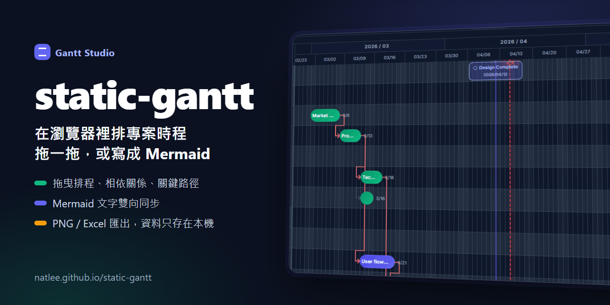
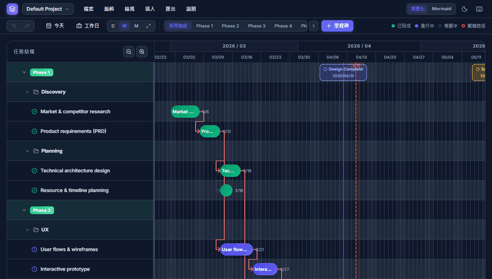
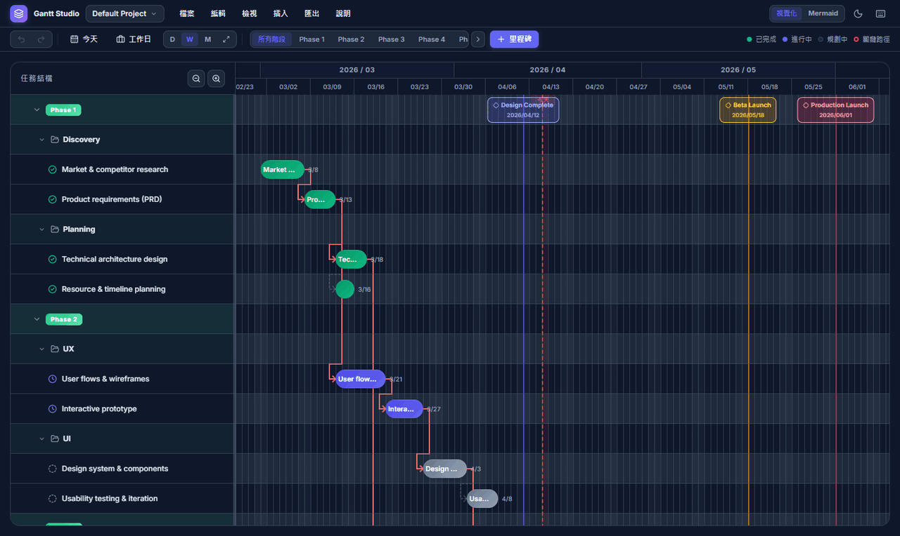
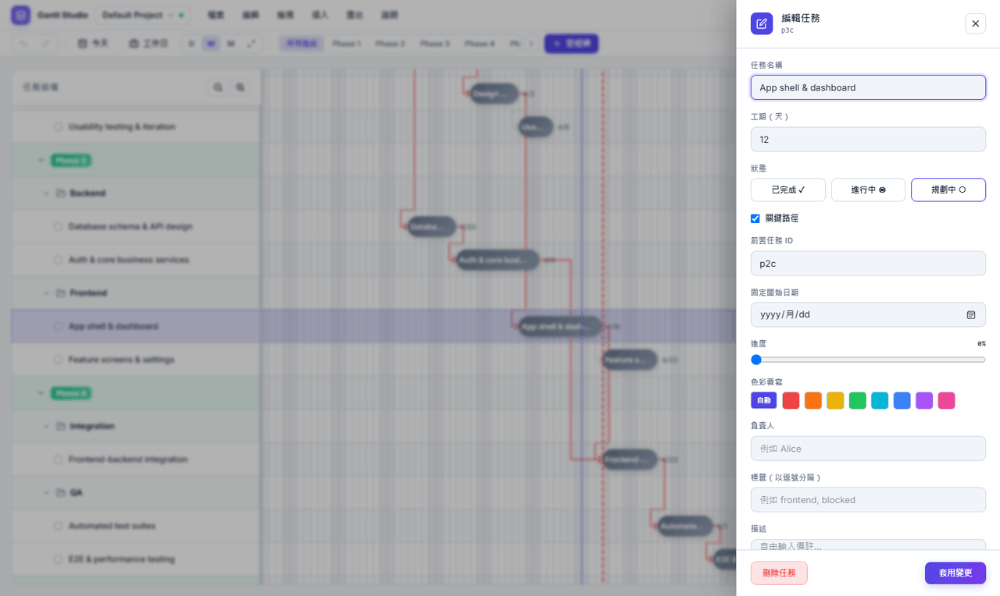
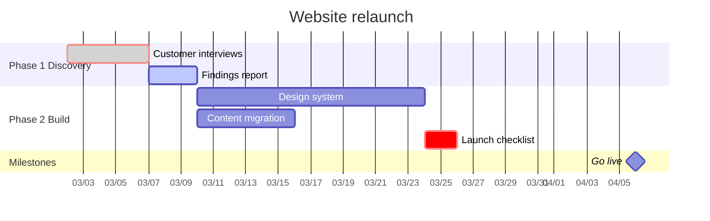
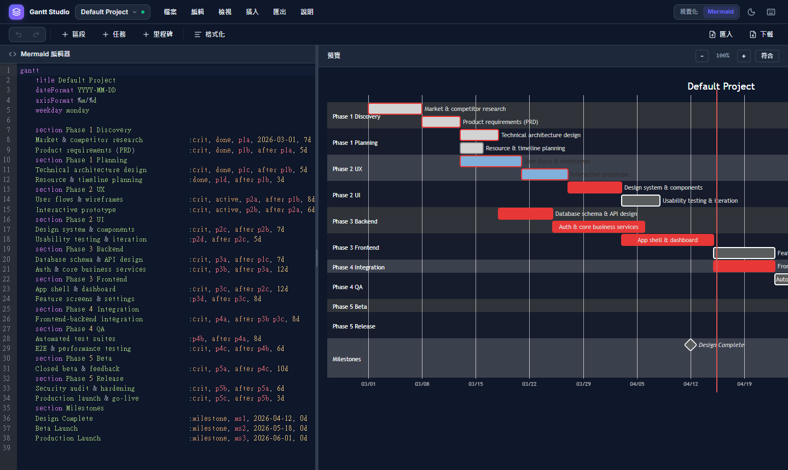
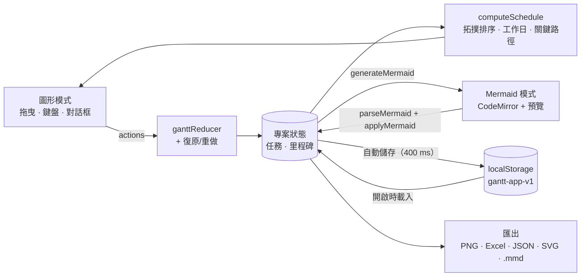

<p align="center">
  
</p>

# static-gantt

[](https://github.com/NatLee/static-gantt/actions/workflows/deploy.yml)
[](https://natlee.github.io/static-gantt/)


**Gantt Studio** 是純前端的甘特圖編輯器。在圖上拖曳任務排時程、拉線建立相依關係，程式會自動排出日期並標出關鍵路徑。同一份計畫可以切到 Mermaid 文字模式編輯，兩邊雙向同步。沒有後端，也不用登入：專案只存在你自己的瀏覽器裡，可以匯出 PNG、Excel 和 JSON。

**線上使用：<https://natlee.github.io/static-gantt/>**

> **English summary.** Gantt Studio is a browser-only Gantt chart editor. Drag tasks to schedule them, draw dependencies, and let it work out the dates and the critical path; switch to Mermaid text mode to edit the same plan as text, with two-way sync. There is no backend: projects stay in your browser's localStorage and export to PNG, Excel or JSON. The UI speaks English, 繁體中文, 简体中文 and 日本語, and every part of the chart works from the keyboard.

<p align="center">
  
</p>

## 功能

- **兩種編輯方式**：圖形模式直接拖曳；Mermaid 模式用文字編輯並即時預覽。切換模式時，Mermaid 寫不出來的欄位（進度、顏色、負責人、標籤、說明）會照任務 ID 保留。
- **三層結構**：大階段（`Phase 1`）→ 子階段（`Discovery`）→ 任務，可以個別或全部折疊，也可以只看某個大階段。
- **拖曳**：左右拖改開始日，上下拖到別的子階段，拉右緣改工期；左側列表可以拖曳重排大階段、子階段和任務。
- **相依關係**：從任務條兩端的圓點拉線到另一個任務。會形成循環的連線會變紅並拒絕；點相依線可以刪除。
- **自動排程**：有前置任務的任務，在最晚的前置任務結束後開始；可以切成「只算工作日」跳過週末。
- **關鍵路徑和浮時**：關鍵任務有紅框，提示框會顯示每個任務還能延後幾天。
- **基準線**：拍下目前的計畫，之後每個任務條後面會顯示原計畫的位置，提示早了或晚了幾天。
- **其他**：里程碑、同一人工作重疊的警示、搜尋（`Ctrl+F`）、復原與重做（50 步）、深色和淺色主題、四種語言。
- **多專案和自動儲存**：新增、複製、改名、刪除專案；每次修改都自動存到瀏覽器。可以下載單一專案或全部備份成 JSON，之後再匯入。
- **匯出**：整張圖 PNG、Excel（.xlsx）、專案 JSON；Mermaid 模式另外可以匯出 SVG、PNG 和 .mmd 檔。

<p align="center">
  
  
</p>

## 快速上手

1. 打開 <https://natlee.github.io/static-gantt/>，第一次會載入一份範例專案。
2. 點任務條打開編輯面板；拖曳任務條改日期；從任務條右端的圓點拉線到另一個任務，建立相依關係。
3. 要開新專案，用「檔案 → 新增（空白）」或「從範本新增」。
4. 右上角切到 **Mermaid**，就能用文字編輯同一份計畫；切回 **視覺化** 時會套用修改。
5. 「匯出」選單可以下載 PNG、Excel 或專案 JSON。要換電腦時，用「檔案 → 下載備份（全部）」，再到新電腦「匯入 JSON…」。匯入完整備份會取代這個瀏覽器裡的所有專案，匯入前會先問你。

## 鍵盤操作

按 `?` 可以在程式裡看到這張表。

| 按鍵 | 動作 |
|---|---|
| `?` | 顯示快捷鍵表 |
| `Esc` | 關閉對話框、面板或選單 |
| `Ctrl`/`⌘` + `Z` | 復原 |
| `Ctrl`/`⌘` + `Shift` + `Z`、`Ctrl`/`⌘` + `Y` | 重做 |
| `Ctrl`/`⌘` + `F` | 搜尋任務 |
| `T` | 捲到今天 |
| `+` / `-` | 放大 / 縮小時間軸 |
| `Tab` | 在任務條、列表和按鈕之間移動 |
| 任務條上 `Enter` | 打開任務編輯 |
| 任務條上 `←` / `→` | 提早 / 延後一天（和拖曳一樣，會改成固定開始日） |
| 任務條上 `Shift` + `←` / `→` | 工期減少 / 增加一天 |
| 任務條或列表上 `Shift` + `F10`（或選單鍵） | 打開右鍵選單 |
| 選單裡 `↑` / `↓` / `Home` / `End` | 移動選項 |
| Mermaid 編輯器 `Ctrl`/`⌘` + `Shift` + `S` / `T` / `M` / `F` | 插入區段 / 任務 / 里程碑、對齊格式 |

## Mermaid 文字模式

Mermaid 模式用的是 [Mermaid 甘特圖語法](https://mermaid.js.org/syntax/gantt.html)。每個 `section` 是一個子階段；名稱用 `Phase N 子階段` 的形式時，會歸到第 N 個大階段底下，其他名稱會放在「Other」底下。下面這段可以直接貼進 Mermaid 模式（GitHub 也會把它畫成圖）：



- 每行是 `名稱 :標記, ID, 開始日或 after 前置ID, 工期`。工期用 `d`（天）或 `w`（週）。
- 標記可以是 `crit`（關鍵）、`done`（已完成）、`active`（進行中），可以省略。
- `after b1 b2` 表示等 `b1` 和 `b2` 都結束才開始，可以列很多個。
- `milestone` 加上日期的那一行會變成時間軸上的里程碑。

切回圖形模式時，進度、顏色、負責人、標籤和說明這些 Mermaid 沒有語法的欄位，會照任務 ID 保留；里程碑的顏色照里程碑 ID 保留。



## 運作方式

整個程式都在瀏覽器裡跑：狀態放在一個 reducer，畫面和排程都從它算出來，再由自動儲存寫進 localStorage。



- 日期以「日曆日」為單位，在任何時區都是同一天；「今天」用你電腦的日期。
- 排程依相依關係的拓撲順序計算，任務多、順序亂都排得出來；前置任務不存在或互相循環的任務不會畫出來。
- 存在瀏覽器的資料格式（版本 1）沒有變過，舊版存的專案和備份檔都能直接開。

## 本機開發

需要 Node.js 24（見 `.nvmrc`；22.12 以上也可以）。

```bash
npm ci
npm run dev        # http://localhost:3000
```

其他指令：

```bash
npm run lint       # ESLint（含 React Compiler 規則）
npm run typecheck  # TypeScript 型別檢查
npm test           # 單元測試（Vitest）：排程、相依、Mermaid 轉換、存檔格式、時區
npm run build      # 靜態輸出到 ./out

# 瀏覽器冒煙測試（Playwright）：先用 GitHub Pages 的路徑 build，再測
NEXT_PUBLIC_BASE_PATH=/static-gantt npm run build
npx playwright install chromium   # 第一次才需要
NEXT_PUBLIC_BASE_PATH=/static-gantt npm run test:e2e
```

在 Windows 的 Git Bash 執行時，路徑開頭的 `/` 會被自動轉換，要先 `export MSYS_NO_PATHCONV=1`。

## 部署到 GitHub Pages

`.github/workflows/deploy.yml` 會在推到 `main` 時先跑完整的檢查（lint、型別、單元測試、build、冒煙測試），全部通過才 build 並部署。Pull request 也會跑同一套檢查（`.github/workflows/ci.yml`）。

第一次部署要到 repo 的 **Settings → Pages → Source** 選 **GitHub Actions**。`NEXT_PUBLIC_BASE_PATH` 由 workflow 依 repo 名稱帶入，本機開發不用設定。

## 專案結構

```
src/
├── app/             # Next.js App Router、全域樣式
├── components/
│   ├── Gantt/       # 圖表：任務條、列表、相依線、里程碑、右鍵選單
│   ├── Dialogs/     # 共用的 Dialog 外框，以及新增、專案清單、快捷鍵等對話框
│   ├── Editor/      # 任務編輯面板
│   ├── Header/      # 選單列和工具列
│   └── Mermaid/     # Mermaid 編輯器和預覽
├── data/            # 範例專案
├── hooks/           # reducer（useGanttState）、自動儲存、拖曳、鍵盤
├── i18n/            # 四種語言的字典（en 是基準）
├── lib/             # 排程、日期、相依、Mermaid 轉換、存檔、匯出
└── types/           # 共用型別
e2e/                 # Playwright 冒煙測試和靜態伺服器
docs/images/         # README 圖片和封面（cover.html 是封面的原始檔）
```

## 授權

MIT，見 [LICENSE](LICENSE)。
